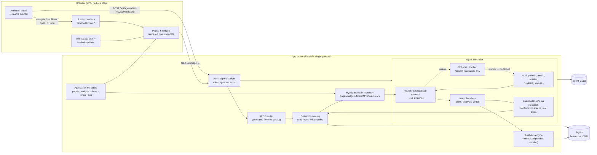
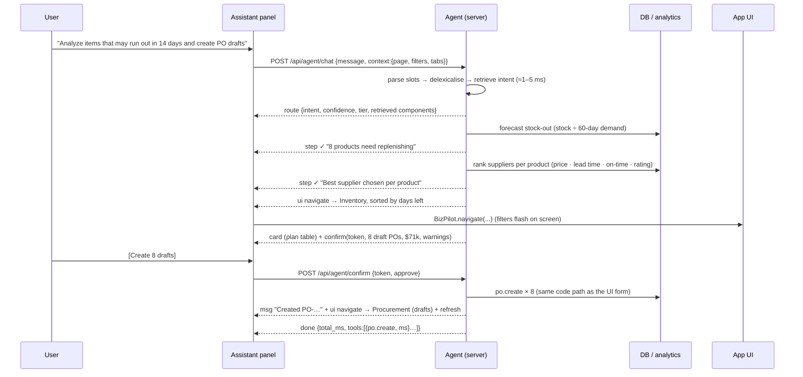

# BizPilot AI — Architecture & Design

*Problem 5A: a context-aware application agent, embedded in a supply-chain & business-operations app.*

## 1. What we are building, and why this domain

A business owner / operations manager runs a distribution business: ~46 products across 4 warehouses, 48 suppliers, 120 customers,
~7,000 orders and ~740 purchase orders over 24 months. They spend their day moving between pages, setting filters, comparing
periods and raising purchase orders. **The assistant lives inside the application and does that work for them** — it navigates,
sets filters, fills forms, answers analytical questions with evidence, and prepares changes that the user confirms.

Supply chain & business management was chosen because it gives the most to *do* and to *explain* in a demo: money (revenue, spend,
receivables), operations (stock, shipments, lead times), governance (approval limits, audit) and a story the data can tell
(a metals-supply disruption that shows up as late POs → stock-outs → cancellations → a revenue dip).

### How your notes map to the design

| Note | Design decision |
|---|---|
| Agent is **embedded**; has the complete application info (DB, file/metadata structure) | The agent runs *inside* the app server, behind the same session. It reads the same **page/widget/filter registry** the UI renders from (`server/pages.py`) and the same **operation catalog** the REST API is generated from (`server/ops.py`). One source of truth → the agent cannot drift from the app. |
| **Latency** — normal agents are slow (click, wait, click) | No browser automation in the hot path. UI actions are applied through the app's own state API (`window.BizPilot.navigate`), the router is a deterministic **fast path** (no LLM), the index/lexicon live in memory, metrics are memoised per data-version, events are **streamed** so the UI moves before the explanation text is ready. Measured: **p50 2 ms, p95 12 ms** end-to-end in-process (§6). |
| Chatbot must perform **complex tasks on our behalf** | Multi-step plans with visible steps (“Analyzing inventory… Comparing suppliers… Sizing orders… Ready for review”): e.g. *find everything running out in 14 days → best supplier each → size orders → group by supplier → draft POs → you confirm*. |
| **Login required** | Signed-cookie session; every agent/REST call authenticates; the approval limit of the signed-in role bounds what the agent may do (Manager ≤ $100k, Admin unlimited). |
| **Tabs** boost productivity | Workspace tabs; the agent can open any set of pages side by side (“open inventory and suppliers in new tabs”). Tab state is persisted and deep-linkable (`#/inventory?status=low_stock`). |
| Should **fill details automatically** | Forms are metadata-driven; the agent opens one and fills it field by field in front of the user (supplier, product, qty, price from the supplier price list, expected date from lead time). |
| **Each page has an id** so the agent understands | `data-page-id` on the page root and tabs, `data-widget-id="inventory.stock_table"` on every widget; `window.BizPilot.snapshot()` returns what is on screen. The client sends `{page, filters, tabs}` with every turn. |
| If asked about the page, **tell about the current page** | `explain_page` intent: purpose, live filters, headline figures *as currently shown*, widgets, which filters it can set. |
| **Manager's** and **business owner's** point of view | Approvals queue with role limits, receivables, procurement spend, stock-out risk, executive report generator, audit trail. |
| 8 pages | 8 business pages (Dashboard, Inventory, Suppliers, Procurement, Sales & Orders, Logistics, Finance, Analytics) + 2 governance pages (Approvals, Agent Activity). |
| **Assistant is the main focus**: latency, retrieval, DB management, CRUD | See §4–§6 and the CRUD matrix below. |
| **Semantic search**; agent searches through **APIs**; finds the **right API** | Hybrid retrieval index over pages, widgets, filters **and API operations**; `find_components()` is kind-aware (API-sounding queries favour operations). |
| Delete is **optional** | Implemented, but only for **draft** POs, destructive-styled, always confirmed. Nothing else can be deleted. |
| Agent has **complete access** and can navigate **all pages** | All 10 pages and all 18 operations are reachable; access is bounded by *role limits and confirmation*, not by missing tools. |
| **12–24 months** of data | 24 months of deterministic synthetic data, with planted events the agent must *discover* (§5). |

**CRUD coverage** (what the agent can do, and with what safeguard):

| | Operation | Safeguard |
|---|---|---|
| **C**reate | purchase order (single, or bulk replenishment plan), supplier | pre-filled form *or* confirmation card; POs are created as **drafts** |
| **R**ead | every page, metrics, trends, comparisons, rankings, forecasts, supplier ranking, entity lookup, reports | none needed; every number is traceable |
| **U**pdate | submit / approve / reject / receive a PO, stock quantity & reorder level, order status, supplier status | confirmation with before → after diff; role approval limit; state-machine checks |
| **D**elete | draft PO only | destructive confirmation; refuses non-drafts |

## 2. System architecture

**Single source of truth.** `pages.py` declares every page (id, description, filters, widgets) and the builder that produces its data.
The browser renders *generically* from that metadata; the agent's knowledge of “what exists, what can be filtered, what values are
valid” is generated from the same structures. `ops.py` declares every operation once (description, params, risk) and generates
the REST route, the agent tool, and a retrieval document from that one declaration.

*For a real no-code platform*, the registry would be produced by an importer from the platform's exported metadata (navigation tree,
page/widget catalog, data-view and filter schemas) — the rest of the pipeline is unchanged.

## 3. One request, end to end

Nothing between “route” and “confirm” writes to the database. The confirmation token is single-use, bound to the user and
expires after 15 minutes. If the user instead saves the pre-filled form manually, the chat's duplicate confirm button retires itself.

## 4. The agent pipeline

1. **Parse (NLU)** — `periods.py` (last quarter, Q2 vs Q3, March 2026, from Jan to Mar…), metric detection, numbers/horizons,
   statuses, sort phrases, PO/SO ids, and **entity linking against the live database** (full product names, partial names such
   as “steel” → a *group* of products, suppliers without corporate suffixes, customers, warehouses, regions). The agent can only
   refer to things that exist.
2. **Route** — the utterance is *delexicalised* (“create a PO for 500 Steel Rod from Global Metals” → `create a po for numtok
   entproduct from entsupplier`) and matched against 265 exemplar utterances (25 intents) in the hybrid index; additive **cue
   evidence** (wording + slots) sharpens it. Accept only if score ≥ 0.75 *and* margin ≥ 0.10.
3. **Unsure?** → *Tier 2 (optional LLM):* Claude (default `claude-haiku-5-5`) picks an intent and **rewrites** the request into an
   explicit command; the rewrite goes back through steps 1–2 and the same guardrails. The model never answers questions, never sees
   data, and cannot execute anything. *No key / API failure →* **Tier 3:** a clarification with the closest intents and pages.
   The assistant asks rather than guesses.
4. **Handle** — handlers are generators of events: `step`, `ui`, `card`, `msg`, `chips`, `confirm`, `done`.
5. **Guard** — see §7. 6. **Audit** — every turn and every confirmed write is logged with tier, intent, confidence, tools + latency.

**Follow-ups** (“and for Europe?”, “what about last quarter?”) inherit metric/period/region from the previous analytic turn.

### Retrieval layer (“semantic search”, “find the right API”)

`server/retrieval.py`: canonical word stems (domain synonym folding, e.g. *vendor→supplier, stockout→stock out, cheapest→price*),
word bigrams and character 3-grams (typo tolerance), TF-IDF cosine through an inverted index. Documents: **10 pages, 37 widgets,
39 filters, 18 API operations, 265 intent exemplars** (369 total). `find_components()` weights kinds by query shape (API words → APIs;
“filter / limit / sort” → filters). It is lexical-semantic, **not** dense embeddings; the `Index` interface is what a FAISS / pgvector
sentence-embedding backend would replace at larger scale (§8).

## 5. Analytics that can be trusted

Every number comes from `server/analytics.py`; text is composed from computed results, never free-generated. Highlights:

* **Metrics**: revenue, orders, units, AOV, profit, expenses, cancellations, on-time rate, delayed shipments, procurement spend,
  inventory value, active suppliers, receivables — by month / day / category / region / product / customer / warehouse / supplier.
* **Period handling**: “last N months” = N calendar-month buckets **through today**, and the current partial month is flagged
  *month-to-date* and **excluded from trend statistics** (so a half-finished month never looks like a collapse); month-to-date vs a
  full previous month is compared **like-for-like** (same elapsed days).
* **Explain a change** (`diagnose`): contribution by category / region / product; cancellation and on-time deltas; delayed
  shipments; **inbound-PO lateness per supplier**; expenses; mix vs price. A “likely cause” sentence is produced **only when the
  evidence chain exists** (top negative driver in category X + late POs from X's suppliers + cancellations up), and always says it
  is a pattern, not proof. Each bullet carries a **source chip** that deep-links to the supporting view.
* **The planted story** (as of 2026-10-10): Mar 2026 metals disruption — Metals revenue −64% vs Feb, cancellations 4.8% → 14.0%,
  on-time 92.9% → 70.0%, Global Metals / Steel Supplies POs ~12.5 days late. The agent finds this from data;
  nothing in the agent code knows about it (a test asserts this).
* **Stock-out forecast**: stock ÷ average daily demand of the last 60 days. **Supplier score**: weighted price index, lead time,
  on-time %, rating (weights change with “cheapest / fastest / most reliable”).

## 6. Latency

What the design removes: the browser round-trips of click-by-click automation, a network hop to a separate agent service, an LLM
call for routine requests, and repeated computation.

* Fast path has **no LLM call**; routing is dictionary + sparse-vector work in process (index built at start-up).
* Metrics are memoised on `(function, args, data_version)`; any write bumps the version.
* A page's widgets are all built server-side in one request (3–31 ms measured for the 10 pages here).
* Events stream; the UI acts on `ui` events while analysis continues. Each turn shows its own latency and a **trace**
  (routing ms, retrieved components, tool calls with ms) in the panel.

Measured by `python -m eval.run_eval` (warm, 268 turns, in-process, SQLite on local disk): **p50 2 ms · p95 12 ms · max 21 ms**;
the first request after start-up took ≈ 40 ms in the benchmark (index and lexicon are pre-built at start-up; caches cold). This excludes network and browser rendering, and no LLM call is involved. We did **not**
benchmark a Playwright-based agent, so no “×faster” claim is made; the claim is architectural. If the optional LLM tier is used,
expect its API latency (typically hundreds of ms to seconds) on only the requests the fast path could not place.

## 7. Safety model

| Risk | Control |
|---|---|
| Hallucinated page / filter / value | Every `navigate` is validated against the page's declared filter schema (`validate_filters`); unknown values are dropped and reported. Measured: 0 invalid actions in 268 turns. |
| Hallucinated entity | Entities are linked to database rows; unknown names are never turned into records. Ambiguous partial names → the agent lists real candidates and asks. |
| Silent state change | Handlers only **plan**; writes happen in `confirm()` after the user clicks. Test: DB version unchanged during every write request. |
| Over-reach | Role limits (Manager ≤ $100k); POs > $50k route to approvals; delete is draft-only; order status follows a state machine; `unsupported` intent explicitly refuses email, payments and bulk-delete of master data. |
| Prompt injection | The LLM sees only the user's own sentence + intent list; its output is schema-validated (intent enum, ≤300-char rewrite) and re-parsed; data fields (supplier names, notes) never enter a prompt. |
| Replay / cross-user | Confirmation tokens are single-use, user-bound, 15-minute TTL. |
| Accountability | `agent_audit` table + “Agent Activity” page. |

## 8. Evaluation (what was measured, honestly)

`python -m eval.run_eval` — runs on a copy of the database; writes `eval/results.json`, rendered on the **Agent Activity** page.

| KPI | Result |
|---|---|
| Intent routing, **fresh held-out v2** (69 utterances, written after tuning, run once) | **78.3 %** |
| Intent routing, held-out v1 **first run** (70 utterances, before any fix) | **75.7 %** |
| Intent routing, dev + v1 (tuned on; regression tracking only) | 100 % (199) |
| Destination / UI-state exactness / slots on fresh v2 | 78.9 % / 72.2 % / 95.5 % |
| Multi-step task success (verified in the DB) | 10 / 10 scenarios |
| Numeric answers vs independent hand-written SQL | 6 / 6 |
| Evidence links valid in a “why” answer | 9 / 9 |
| Retrieval MRR@10 over 369 docs · with +600 hard distractors | 0.95 · 0.83 |
| Invalid UI actions · writes without confirmation | 0 / 268 · 0 / 268 |
| Out-of-scope requests handled safely (fresh v2, 6 cases) | 83.3 % (the miss: “refund customer order …” showed the order card — read-only, never refunded; since patched) |
| Latency p50 / p95 | 2 ms / 12 ms |

**How to read these numbers.** The corpora are synthetic and written by the same person who built the router, so even the fresh set
is optimistic. The fast path is a rule-plus-retrieval system: it is excellent on well-formed business phrasing and it **misses
typos and idioms** (“procurment page”, “start fresh”, “what could we run short of”, “which items will hit zero”), which is exactly what the
optional LLM tier is for — that tier is covered by unit tests with a stubbed transport but was **not exercised against the live API**
(no key in the build environment). 100 % on the tuned sets reflects fitting, not generalisation. No real-user study was run.
Retrieval queries were also author-written, and API docs were enriched with usage phrases after a first run scored MRR 0.79.

## 9. Data model (SQLite, WAL)

`users · warehouses · suppliers · products · supplier_prices · inventory(product×warehouse) · customers · sales_orders · so_items ·
shipments · invoices · purchase_orders · po_items · expenses · approvals · agent_audit · meta`. Seed: ~6.9 k orders, 13.9 k lines,
6.7 k shipments, 6.6 k invoices, 737 POs, 530 expense rows over 24 months with seasonality (Nov peak), growth, an APAC surge
and the metals disruption. Business rules: PO > $50k needs approval; order flow `pending → processing → shipped → delivered`
(or `cancelled`, not after delivery); receiving a PO adds stock; suppliers on hold cannot receive new POs.

## 10. Known limitations & what production would change

* **Fast-path language coverage** is bounded (see §8). Production: enable the LLM tier, log fallbacks, and mine them for new exemplars.
* **Retrieval is lexical-semantic.** At thousands of components use dense embeddings (bge/e5) in pgvector/FAISS behind `Index`, with the lexical score as a hybrid signal.
* **Single process.** Sessions, pending confirmations and caches are in memory; run behind sticky sessions or move them to Redis/DB. SQLite → Postgres with row-level security for multi-tenant.
* **Security hardening not done**: demo secret key and demo credentials, no CSRF token (SameSite=Lax only), no rate limiting, passwords PBKDF2-60k, no SSO. Treat as a demo.
* **No browser-automation fallback.** Where a platform exposes no API, a Playwright adapter that implements the same `navigate / set_filters / fill_form` surface would slot in behind `BizPilot.*`; not built.
* **Tabs** are capped at 12 in the UI; each tab re-fetches on switch (fast here, but not virtualised).
* Not covered: mobile layout polish, accessibility audit, i18n/currency, undo for confirmed writes, voice input.
